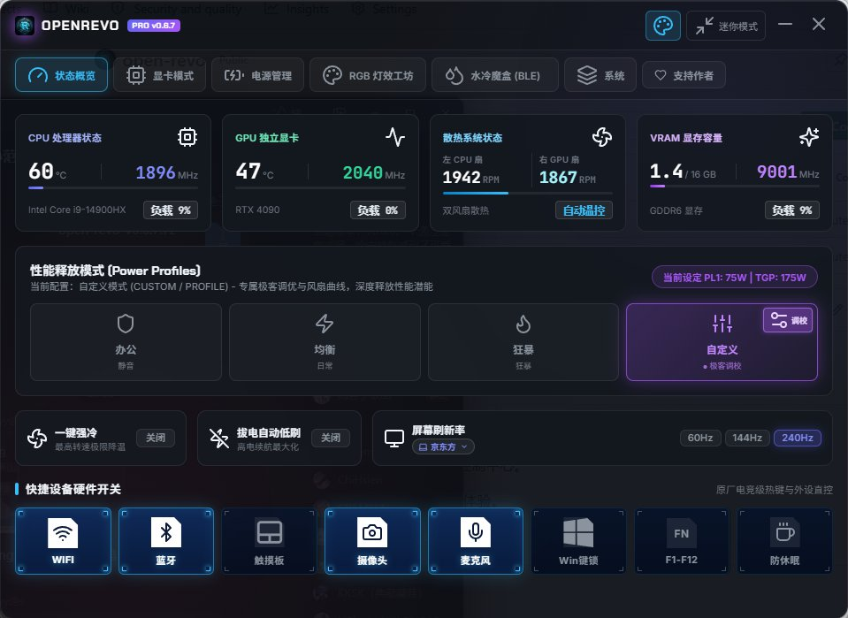
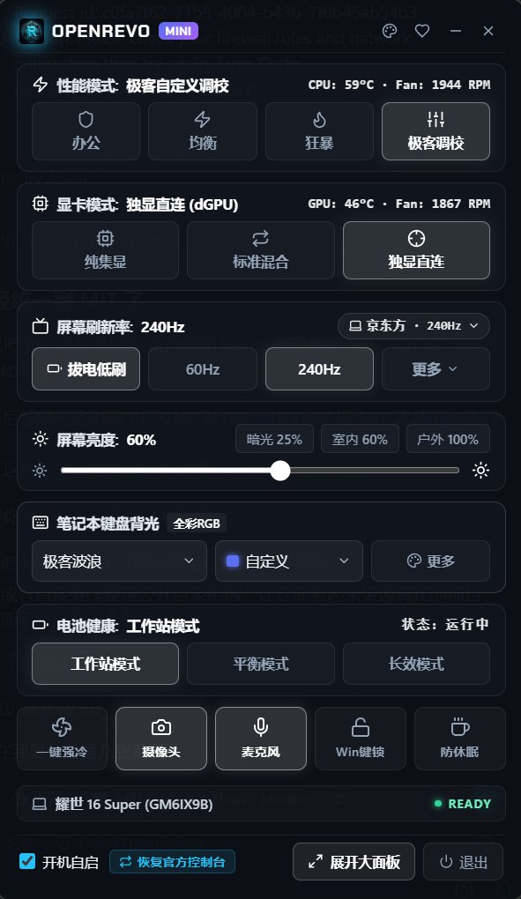
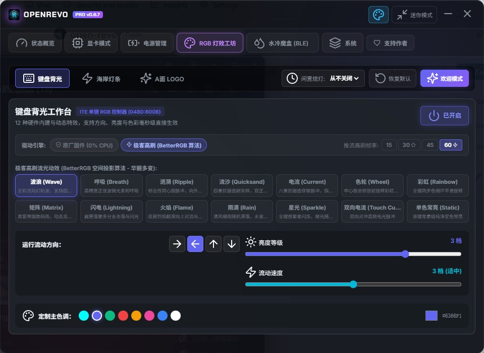
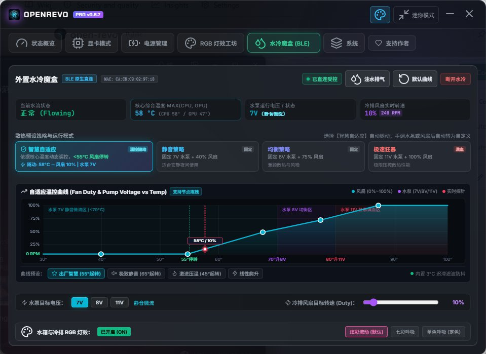

# OpenRevo (开源机械革命 / 同方笔记本控制中心与微内核硬件基座)

<div align="center">

简体中文 | [English](README_en.md)

</div>

<div align="center">


[](https://github.com/faintonce/open-revo/releases)
[](LICENSE)
[](https://slint.dev/)
[](docs/plugins/README.md)
[](#-为什么选择-openrevo从控制中心到微内核硬件基座的质变)
[](#-严正声明开源免费--严禁倒卖)

**专为机械革命 (MECHREVO / TongFang) 笔记本打造的现代化、极致轻量、微内核化全栈开源控制中枢**  
从替代臃肿卡顿、内存泄漏的官方后台服务，全面演进为面向同方与宝龙达全模具生态的 **Slint 原生控制中心 + 高可扩展硬件微内核底座**。  
后台静默常驻物理内存低至 **~4MB**，官方控件零依赖，并配备同类控制软件中最强大的正交双引擎插件与自动化生态。

</div>

---

### 🛡️ 严正声明：开源免费 · 严禁倒卖

> **OpenRevo 为 100% 永久免费且开源的公益社区项目，任何人在任何时间均可免费下载、使用与编译！**  
> **严禁任何个人、二道贩子在闲鱼、淘宝、拼多多、抖音等任何平台或私域群聊中对本软件进行换皮、打包倒卖、收费分发或捆绑销售！**  
> **若您是通过付费购买获得了本软件，说明您遭遇了不良商家的恶意欺诈，请立即向交易平台申请退款并向平台举报侵权商家！**

---

## 🖥️ 界面预览

以下截图展示了 OpenRevo 的核心交互界面与高频功能入口：

### 主界面总览 (Dashboard)


### 极速托盘抽屉 (MiniDrawer)


### BetterRGB 键盘背光调校室 (Lighting Studio)


### 散热 / 功耗精细调控 (Cooling & Power)


---

## 💡 为什么选择 OpenRevo？（从控制中心到微内核硬件基座的质变）

* ⚡ **纯原生 Slint 驱动，后台常驻低至 ~4MB**：主控制中心与游戏 OSD 已全面迁跃至 **Rust + Slint 原生渲染架构**（`openrevo-main` / `openrevo-osd`），彻底摆脱主界面对大内存 WebView2/Chromium 运行时的强依赖。结合纯 Win32 消息循环、按需拉起销毁机制与工作集修剪（`EmptyWorkingSet`），后台待机物理内存从传统方案的 80MB~150MB+ 剧降至 **~4MB**，兼具 60FPS 原生流畅交互与近乎零感知的后台开销，是 Rust + Slint 桌面硬件控制软件的实战级 Showcase。
* 🧩 **同类最强的正交双引擎插件系统**：首创 **Slint 原生 + WebView2 (HTML/JS/React/Vue)** 正交双引擎架构，支持 **Tab 嵌入式页面、独立悬浮窗、无边框透明穿透桌面挂件（Desktop Widgets）与多模态皮肤包** 4 大扩展形态。配合 `plugin_storage` 沙箱存储、双向事件总线、安全硬件网关与声明式 Watcher，插件可直接实现显卡 V/F 曲线调谐、CPU 防缩缸、无级电池限充、AI 硬件调控乃至桌面桌宠等专业级扩展能力。
* 🧠 **微内核事件中枢 (Universal Watcher & Trigger Hub)**：内置原生公共监听与反应中心，支持遥测阈值、前台应用感知、电源插拔边沿、受控 EC 差量 4 大监听通道与 `any`/`all` 复合条件判断。通过**清单声明式规则（Manifest Rules）**，零常驻 Webview 即可实现全生命周期自愈的后台自动化联动。
* 🛡️ **底层模具驱动安全穿透网关 & 硬件防爆盾**：面向极客、插件与 AI 工具开放 `TongfangDirectEc`、`BldWmiMailbox`（宝龙达 ODM 专用）、`GenericAcpiWmi` 与 `IteLightingBus` 4 大底层协议通道，内置**硬件防爆盾（Hardware Blast Shield）**拦截越界与危险寄存器，兼顾极致扩展与物理绝对安全。
* ⌨️ **低级全局键盘钩子总线 (`WH_KEYBOARD_LL`) & 原生 OSD**：Win32 高性能非阻塞物理按键感知，复合修饰键防抖，全屏独占游戏事件无感穿透，实时联动 Multi-call 单二进制原生 Slint OSD 浮窗（含 30s 空闲按需回收）。
* 🌈 **独创键盘背光双引擎 & 原生 HSV 调色盘**：内置 **BetterRGB 空间高刷流光 (15~60 FPS)** 与 **原厂硬件固件 (0% CPU)** 双引擎，集成纯原生 HSV 调色盘，支持平滑自适应流光、冷启动自动恢复与拔电降级。
* 🧊 **智能外置水冷机中控 (BLE)**：原生低功耗蓝牙“主动冲刺 + 零射频被动广播监听”双模架构，通电瞬间秒连，支持水泵转速/风扇曲线精细调校与全方位安全遥测。
* 🎨 **多模态主题引擎与全域换肤 (`Theme` Tokens)**：主控与 OSD 全面收拢至语义化 Design System Tokens，单套皮肤包内支持 **Light（明亮）/ Dark（深色）/ Mono（极简黑白）** 三态色调实时热切换，支持背景图透传与迷你抽屉独立背景配置。
* 🤝 **开源机型与架构分级 (`ChassisArchitectureTier`)**：硬件地址与底层逻辑全面解耦至 `config/ec_registry.json`，并引入基于 NVRAM 的中央机箱架构分级，现已覆盖同方现代模具、30 系 Ampere、10/20 系前代 Pascal/Turing 及宝龙达 ODM 模具。

---

## ✨ 核心功能全景

### 1. 🧩 同类最强的正交双引擎插件生态 (Plugins & Desktop Widgets)
- **双引擎正交承载**：同一套通信协议同时支持高能效 **纯 Rust + Slint 原生扩展** 与经典 **WebView2 (HTML5/JS/React/Vue)** 插件，开发者可按需自由选型。
- **全能插件能力底座**：
  - **沙箱存储 (`plugin_storage`)**：独立的双轨安全持久化存储，插件配置与宿主隔离不冲突；
  - **桌面独立悬浮挂件 (`openrevo-widget`)**：支持无边框透明穿透（`WS_EX_TRANSPARENT`）、丝滑拖拽、开机静默恢复与主程序退出级联销毁；
  - **双向事件总线 & 原生日志路由**：插件可监听或驱动核心模式切换、GPU 频率同步、OSD 提示等全链路状态。
- **官方高阶示范插件矩阵（部分能力已超越传统独立调校工具）**：
  - [`gpu-curve-tuner`](plugins_sample/webview2/gpu-curve-tuner)：免安装 MSI Afterburner，基于原生 NVAPI 物理接管 NVIDIA 127 点 V/F 电压频率曲线，支持交互式拖动调谐、单调性安全门禁与模式切换自动重申；
  - [`cpu-guardian`](plugins_sample/webview2/cpu-guardian)：专为 13/14 代酷睿 HX 打造的防缩缸卫士，合规接入 Intel 官方 7.14 XTU 服务，支持睿频削峰、稳态降压与 30s 防蓝屏回滚；
  - [`battery-hardware-limit`](plugins_sample/webview2/battery-hardware-limit)：基于同方“脉冲触发存储法”实现 **1% ~ 100% 任意数值无级限充**，断电重启持久保持且零后台开销；
  - [`revo-llm-hub`](plugins_sample/webview2/revo-llm-hub)：原生 AI 硬件调控中枢，赋能大模型通过标准化 Function Calling 实时感知工况并调度性能模式、风扇与灯效；
  - [`revo-pet-companion`](plugins_sample/webview2/revo-pet-companion)：桌面透明伴生桌宠挂件，演示跨进程实时遥测驱动动画；
  - [`tongfang-cloud-icc`](plugins_sample/webview2/tongfang-cloud-icc) / [`theme-cream-cup`](plugins_sample/slint/theme-cream-cup) / [`shortcut-workshop`](plugins_sample/webview2/shortcut-workshop) 等更多扩展见 [插件示例源码](plugins_sample/README.md)。

### 2. 🧠 微内核自动化中枢与反应总线 (Universal Watcher Hub)
- **告别后台偷跑与挂件轮询**：彻底颠覆传统插件被迫启动透明隐藏 Webview 挂件导致内存暴增与计时器休眠降频的缺陷；
- **声明式自动化规则 (Declarative Manifest Rules)**：支持在插件 manifest 中直接声明 `watchers` 规则数组与 `any`/`all` 复合条件，支持原生 `call_command` 动作与开机自启基线还原，无需编写前端常驻轮询即可实现全生命周期自愈的自动化联动；
- **4 大底层监听评估通道**：
  - `telemetry`：CPU/GPU 结温、功耗模式、风扇实时转速阈值；
  - `foreground_process`：极轻量 Win32 前台游戏与专业软件感知；
  - `power_event`：AC/DC 充电器拔插、开合盖、屏幕睡眠/唤醒状态流；
  - `raw_ec_diff`：受防爆盾保护的物理 EC 状态差量追踪；
- **NVAPI 防独显误唤醒守则**：全链路遵循低功耗休眠原则（结合进程内 NVML 采样），无监控需求时独显保持休眠，插件零增量内存占用。

### 3. 🛡️ 底层硬件网关与防爆盾 (Raw Driver Gateway & Blast Shield)
- 面向社区插件开发者与 AI Agent 暴露安全的硬件通信原语：
  - **同方原生 EC (`TongfangDirectEc`)**：同方模具原生寄存器直接安全读写；
  - **宝龙达 WMI 邮箱 (`BldWmiMailbox`)**：蛟龙 16 Pro / 无界 14 Pro 等宝龙达机型邮箱指令与原生高精度测温通道；
  - **通用 OEM ACPI-WMI (`GenericAcpiWmi`)**：通用 WMI 硬件方法调用；
  - **ITE 单片机灯控总线 (`IteLightingBus`)**：8291/8297 等单片机原生数据包直通；
- **硬件防爆盾 (Hardware Blast Shield)**：在内核交互层布设安全断言矩阵，强制拦截 `0x0000..0x0FFF` 以外的非法越界访问，并内置关键危险寄存器黑名单，物理阻断任意越界写入或恶意破坏。

### 4. 🌈 键盘背光双引擎架构与高级拓扑覆盖
- **极客高刷推流引擎 (BetterRGB 空间投影算法 & 定制脚本工作室)**：
  - 空间多维几何插值，15 FPS ~ 60 FPS 逐帧平滑动态渲染，提供波浪、正弦呼吸、同心涟漪、丝滑流沙、烈焰翻滚等 14 种绚丽动效；
  - **开放式 `.brfx` 脚本工作室**：基于轻量安全 Rhai 脚本引擎，支持用户手写逐键数学几何动效、极坐标繁花、天体黑洞、全键盘文字弹幕，支持实时热重载（详见 [BetterRGB 自定义灯效脚本开发指南](docs/core/better-rgb-scripting.md)）；
  - 感谢 [Better RGB](https://github.com/ZavierChen/BetterRGB-ITE8291-Adaptive) 的先驱探索；
- **原厂硬件固件引擎 (0% CPU 模式) & 原生 HSV 调色盘**：
  - 由键盘主控芯片硬件定时器独立驱动，零 CPU 占用，极致省电；集成原生 HSV 调色盘，支持单区全彩、单色白光、四区及独立 ITE USB 芯片全系适配；
- **高级硬件拓扑覆盖 (Lighting Topology Override)**：
  - 支持图形化热重置覆盖各机型灯控区域映射，解决错位、盾牌/字母 Logo 不亮或偏色问题；
- **智能交接守护**：冷启动自动恢复、拔掉电源平滑降级硬件流光、插电瞬间恢复高刷渲染，软件退出背光绝不灭灯。

### 5. 🎚️ 极客自定义调校与多代际模具兼容 (Custom Tuning & Chassis Tiers)
- **四大运行模式**：办公模式 (Office)、均衡模式 (Balance)、狂暴模式 (Turbo/Beast，含子模式与 GPU 超频联动)、极客自定义调优模式 (Custom)；
- **全系同方/宝龙达代际覆盖**：依托 `ChassisArchitectureTier`，完整适配现代模具、**30 系 Ampere**（含 `RamFan1p5` 曲线与一键强冷）、**10/20 系 Pascal/Turing 前代模具**与 **宝龙达 ODM**（含 cTGP 下调与原生测温）；
- **CPU / GPU 精细功耗释放**：精细管控 PL1 / PL2 / PL4、温度墙与 Dynamic Boost 调度，支持原生进程内 NVML 实时采样；
- **多阶梯阻尼风扇曲线**：支持双通道独立曲线及单通道/联动风扇（如无界系列）自适应控制，内置阻尼滤波杜绝风扇震荡；
- **实体 Q-Key 状态机闭环**：原生状态机闭环修复机身物理按键指示灯偏色卡死。

### 6. 🧊 智能外置水冷机、显卡拓扑与双轨更新
- **外置水冷机 (BLE)**：被动广播监听 + 主动冲刺双模秒连，彻底消除蓝牙音频爆音，支持水泵/风扇温控曲线调校与防呆防护；
- **显卡拓扑与显示色彩**：独显直连 (dGPU) / 混合输出 (Hybrid) / 纯核显安全互斥锁（防止超极本误切黑屏）、多显示器刷新率独立切换、MiniLED 局域控光、色彩增强与同方原厂云端 ICC 校色一键应用；
- **外设战术开关与热键**：触控板锁定、摄像头硬件防窥 (`e-shutter`)、Win 键锁、`Fn+Sc` 180° 屏幕翻转、`Fn+F4` Wi-Fi 开关与通电开机；
- **双轨增量自动更新**：支持 **稳定通道 (Stable)** 与 **尝鲜通道 (Beta)** 自由切换，配备多源智能镜像测速、SHA256 校验与一键热替换升级。

---

## 🏗️ 架构设计全景图 (Workspace & Microkernel Architecture)

```
┌────────────────────────────────────────────────────────────────────────┐
│               原生 Slint 界面层 & 正交双引擎插件生态                    │
│   - openrevo-main (原生 Slint 主控中心 + 托盘极速抽屉, 后台常驻 ~4MB)   │
│   - openrevo-osd  (Multi-call 单二进制伴生原生 Slint 游戏 OSD)          │
│   - openrevo-widget (无边框透明穿透桌面挂件引擎)                        │
│   - 正交双引擎插件 (Slint 原生 / WebView2) & 三态主题皮肤包 (Theme)      │
└───────────────────────────────────┬────────────────────────────────────┘
                                    │ 匿名管道 / 异步 IPC / 安全沙箱通信桥
┌───────────────────────────────────▼────────────────────────────────────┐
│                    openrevo-core 微内核中枢 & SDK 门面                  │
│  ┌───────────────────────────────┐   ┌───────────────────────────────┐ │
│  │  OpenRevoEngine & Watcher Hub │   │  Global Shortcut Bus (钩子)   │ │
│  │  遥测 / 进程 / 电源 / EC 差量 │   │  WH_KEYBOARD_LL 全局非阻塞调度│ │
│  └───────────────────────────────┘   └───────────────────────────────┘ │
│  ┌───────────────────────────────────────────────────────────────────┐ │
│  │         底层模具驱动网关 (Raw Hardware Driver Gateway)            │ │
│  │   TongfangDirectEc │ BldWmiMailbox │ GenericAcpiWmi │ IteBus      │ │
│  └───────────────────────────────┬───────────────────────────────────┘ │
│                                  │ 经过                                 │
│  ┌───────────────────────────────▼───────────────────────────────────┐ │
│  │             硬件防爆盾 (Hardware Blast Shield)                    │ │
│  │   物理寄存器范围严格断言 (0x000..0x0FFF) + 敏感危险控制寄存器黑名单 │ │
│  └───────────────────────────────┬───────────────────────────────────┘ │
└──────────────────────────────────┼─────────────────────────────────────┘
                                   │ 暴露标准 C-ABI (openrevo-ffi) / 内部调用
┌──────────────────────────────────▼─────────────────────────────────────┐
│          硬件抽象层与开源机型配置 (HAL & ChassisArchitectureTier)        │
│  - 编译期异或混淆钥匙库 (Vault Core)                                    │
│  - 开源机型配置文件：src-tauri/config/ec_registry.json                 │
│  - 真实物理驱动 (DriverHAL) / 零设备依赖仿真驱动 (MockHAL)              │
└────────────────────────────────────────────────────────────────────────┘
```

---

## 🤝 社区多机型适配与 PR 共创指南

OpenRevo 致力于打造属于全同方/机革玩家的通用硬件基础设施。  
主板硬件物理地址已完全解耦至 [`src-tauri/config/ec_registry.json`](src-tauri/config/ec_registry.json)。

如果您拥有尚未完全适配的机型（例如蛟龙系列、旷世系列、耀世系列、无界系列、极光系列、翼龙系列等各年份模具）：
1. 参考 `src-tauri/config/ec_registry.json` 中标准化的寄存器与掩码结构；
2. 抓取或测试您机型的 EC 偏移（功耗墙、电池阈值、风扇 RPM、RGB 寄存器）；
3. **欢迎向本项目提交 Pull Request！** 让我们一起把所有机革模具点亮！

---

## 🛠️ 技术栈选型

| 层次 | 技术选型 | 优势与设计考量 |
| :--- | :--- | :--- |
| **原生界面引擎** | [Slint](https://slint.dev/) + Win32 / Winit | 主控中心与 OSD 纯原生渲染，后台待机工作集低至 **~4MB**，零浏览器常驻负担 |
| **微内核与 FFI** | [Rust 2021](https://www.rust-lang.org/) (`openrevo-core` / `openrevo-ffi`) | 零成本抽象、无头化核心引擎与标准 C-ABI 跨语言导出，原生 Win32/NVML 直连 |
| **插件混合宿主** | [Tauri v2](https://v2.tauri.app/) + Wry / Slint | 正交承载 WebView2 插件与 Slint 扩展，兼顾现代 Web 开发灵活性与原生极致性能 |
| **硬件协议** | Direct EC / WMI ACPI / NVAPI / NVML / HID / BLE | 深度硬件通信无死角覆盖，全链路防爆盾安全加固 |
| **网络更新** | ureq + Schannel (Windows 原生) | 告别 OpenSSL 臃肿依赖，支持 Stable/Beta 双轨更新与多源智能竞速 |

---

## 📚 文档导航

- [更新日志（CHANGELOG.md）](CHANGELOG.md)：各版本功能演进与修复明细
- [文档首页（docs/README.md）](docs/README.md)：全部文档的入口与阅读顺序
- [核心引擎与 SDK（docs/core/README.md）](docs/core/README.md)：`OpenRevoEngine`、C-ABI（C# / C++ / Linux）接入
- [插件开发（docs/plugins/README.md）](docs/plugins/README.md)：清单规范、Watcher 引擎、能力网关与实战用例
- [机型配置与功耗预设（docs/core/models-customization.md）](docs/core/models-customization.md)：`models.json` 调优
- [插件示例源码（plugins_sample/README.md）](plugins_sample/README.md)：Slint / WebView2 可运行示例与清单入口
- [AI Agent 开发指引（docs/skill.md）](docs/skill.md)：面向 AI 编程助手的技能说明

---

## 🚀 快速上手

### 📥 方式一：直接下载使用（推荐）
前往项目 [Releases 页面](https://github.com/faintonce/open-revo/releases) 下载最新版本单文件免安装绿色版：
1. 下载 `OpenRevo.exe`；
2. 右键以管理员身份运行；
3. 为避免冲突，**接管官方控制中心**是推荐操作；
4. 软件自动最小化至任务栏托盘（常驻内存仅约 **4MB**），随时左键呼出极速抽屉或右键打开主控中心。

---

### 💻 方式二：从源码编译（开发者）

#### 环境准备
- **Node.js** >= 18
- **pnpm** >= 9
- **Rust 工具链** (stable-x86_64-pc-windows-msvc)
- **Visual Studio C++ Build Tools** (含 Windows SDK)

#### 1. 克隆代码仓库
```bash
git clone https://github.com/faintonce/open-revo.git
cd open-revo
```

#### 2. 安装前端依赖
```powershell
pnpm install
```

#### 3. 运行开发环境
```powershell
pnpm tauri dev
```

#### 4. 打包构建独立发布版本
```powershell
pnpm tauri build
```

---

## 📜 开源协议

本项目采用 **[GNU General Public License v3.0 (GPLv3)](LICENSE)** 强互惠协议开源。

- **自由使用与修改**：您可以自由运行、研究、修改与分享本项目的源代码；
- **强制保持开源 (Copyleft)**：任何基于 OpenRevo 修改、衍生或集成的分发版本，必须同样以 GPLv3 协议完全免费开源其全部源代码，**严禁闭源换皮、商业倒卖或据为私有**；
- **著作权声明**：分发时必须保留原作者的版权声明、反倒卖声明与 GPLv3 许可文件全文。

---

## ⚠️ 免责声明

1. 本软件为开源社区独立项目，**非机械革命 (MECHREVO) 或同方官方出品**，与上述品牌无任何商业从属关系；
2. 软件由热心开发者在业余时间维护开发，作者不对使用过程中因用户极限超频、非法篡改硬件参数导致的硬件损伤或数据丢失承担连带责任；
3. 调整功耗墙与风扇曲线时，请保持在安全合理的硬件阈值内，爱护爱机。

---

## ☕ 赞助与支持

OpenRevo 永久免费开源。如果这个项目对你有帮助，欢迎请作者喝杯咖啡，支持项目持续维护与更多机型适配（纯属自愿，无任何功能限制）：

<div align="center">

| 微信支付 (WeChat) | 支付宝 (Alipay) |
| :---: | :---: |
|  |  |

</div>

---

## 💬 社区交流群

欢迎加入 OpenRevo 机友交流群反馈问题、分享机型配置或探讨插件开发：

- **QQ 1 群**：`1124228342`
- **QQ 2 群**：`1127639778`

<div align="center">

**OpenRevo 致力于让每一个机械革命用户享受纯净、流畅、高效的极速掌控体验！**  
如果这个项目帮到了你，欢迎给仓库点个 ⭐ **Star** 支持持续开发！

</div>
