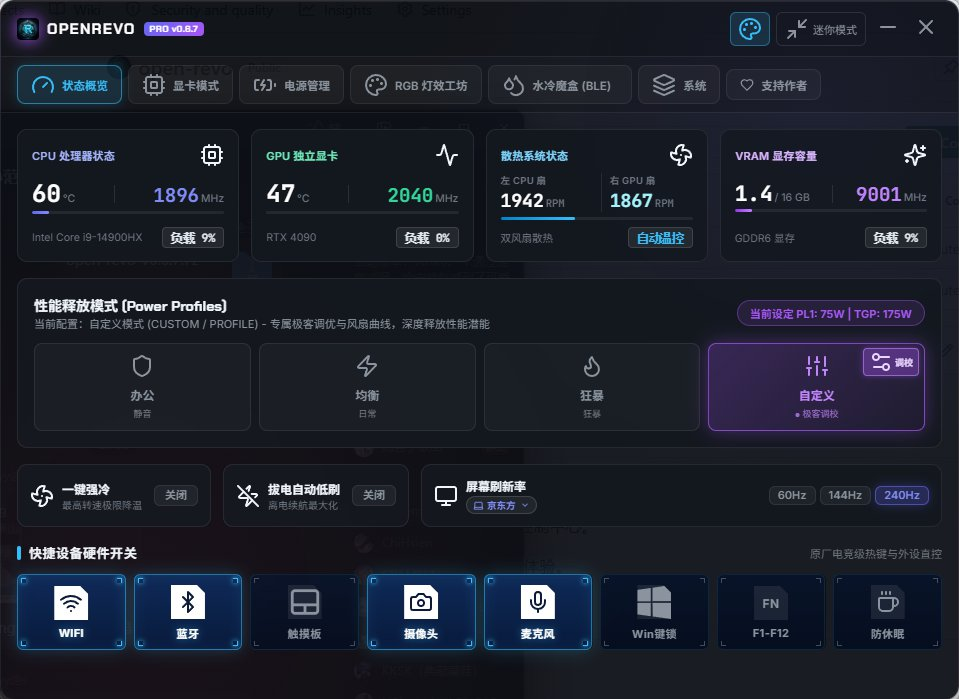
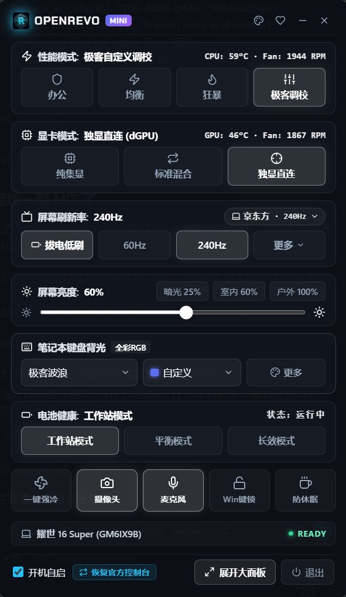
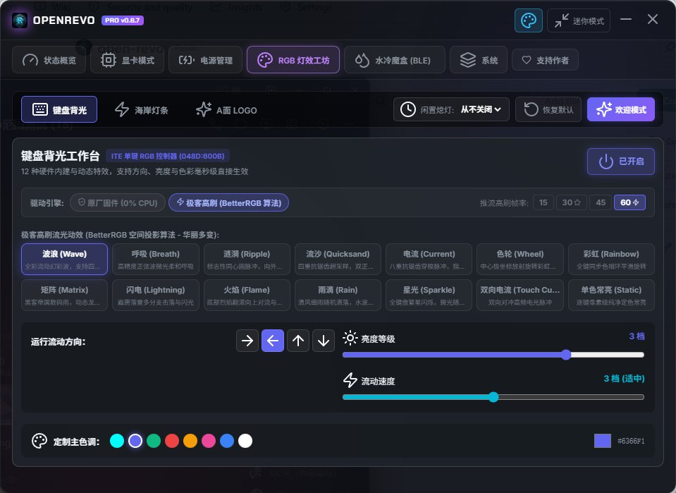
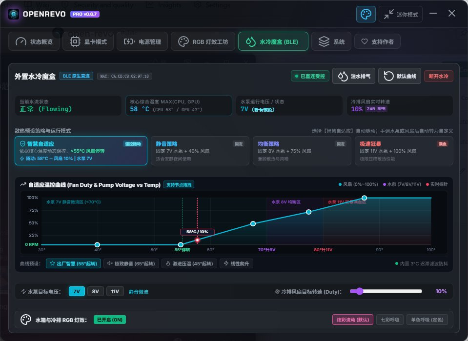

# OpenRevo (Open Control Center & Microkernel Hardware Hub for Mechrevo / TongFang Laptops)

<div align="center">

[简体中文](README.md) | English

</div>

<div align="center">


[](https://github.com/faintonce/open-revo/releases)
[](LICENSE)
[](https://slint.dev/)
[](docs/plugins/README.md)
[](#-why-openrevo-from-control-center-to-microkernel-platform)
[](#-strict-notice-free-and-open-source--resale-prohibited)

**A modern, ultra-lightweight, microkernelized full-stack open-source control center for Mechrevo (MECHREVO / TongFang) laptops**  
Evolved from a lean replacement for bloated, laggy, memory-leaking official background services into a **Native Slint Control Center + extensible hardware microkernel platform** for the entire TongFang & Bitland chassis ecosystem.  
Silent background resident memory down to **~4MB**, zero official dependencies, and an orthogonal dual-engine plugin & automation ecosystem unmatched among laptop control tools.

</div>

---

### 🛡️ Strict Notice: Free and Open Source · Resale Prohibited

> **OpenRevo is a 100% free and permanently open-source community project. Anyone may download, use, and compile it free of charge at any time.**  
> **Individuals and resellers are strictly prohibited from repackaging, rebranding, reselling, charging for, redistributing, or bundling this software on Xianyu, Taobao, Pinduoduo, Douyin, private groups, or any other platform.**  
> **If you paid to obtain this software, you may have been defrauded by a malicious seller. Please request a refund through the transaction platform and report the infringing seller.**

---

## 🖥️ Interface Preview

### Dashboard Overview


### MiniDrawer (Quick Tray Drawer)


### Lighting Studio (BetterRGB High-FPS Engine)


### Cooling & Power Tuning


---

## 💡 Why OpenRevo? (From Control Center to Microkernel Platform)

* ⚡ **Pure Native Slint UI, ~4MB Idle Background Footprint**: The main control center and game OSD have transitioned to a **Rust + Slint native rendering architecture** (`openrevo-main` / `openrevo-osd`), completely eliminating heavy WebView2/Chromium runtime overhead for the core UI. Combined with a pure Win32 message loop, on-demand lifecycle, and working-set trimming (`EmptyWorkingSet`), idle RAM drops from 80–150MB+ down to **~4MB** with smooth 60FPS native responsiveness—making OpenRevo a production-grade showcase for Rust + Slint desktop hardware utilities.
* 🧩 **Unmatched Orthogonal Dual-Engine Plugin Ecosystem**: Pioneering a **Slint Native + WebView2 (HTML/JS/React/Vue)** orthogonal plugin architecture supporting **embedded Tabs, standalone windows, click-through transparent Desktop Widgets, and multi-mode Theme Packs**. Powered by sandboxed `plugin_storage`, a bidirectional event bus, safe raw hardware gateways, and declarative watchers, plugins can deliver capabilities far beyond typical control centers—from GPU V/F curve tuning and CPU undervolting/turbo clamping to stepless charge limits, AI hardware control, and desktop companions.
* 🧠 **Universal Watcher & Trigger Hub (Microkernel Automation)**: Built-in native monitoring channels for hardware telemetry thresholds, foreground app/game detection, AC/DC & lid power events, and controlled EC delta tracking with `any`/`all` composite conditions. Supports **Declarative Manifest Rules** with zero background WebView overhead and full lifecycle self-healing.
* 🛡️ **Raw Hardware Driver Gateway & Blast Shield**: Exposes 4 low-level driver protocols (`TongfangDirectEc`, `BldWmiMailbox`, `GenericAcpiWmi`, and `IteLightingBus`) with a built-in **Hardware Blast Shield** that enforces address boundaries and blacklists critical registers for physical safety.
* ⌨️ **Low-Level Global Keyboard Bus (`WH_KEYBOARD_LL`) & Native OSD**: High-performance non-blocking key state tracking, modifier debouncing, full-screen game passthrough, and a multi-call single-binary native Slint OSD with a 30s idle watchdog.
* 🌈 **Dual Lighting Engines & Native HSV Picker**: Combines **BetterRGB spatial streaming (15–60 FPS)** and **Factory hardware firmware (0% CPU)** with a native HSV color picker, cold-boot restoration, and seamless power-transition handover.
* 🧊 **Smart BLE Liquid Cooler Hub**: Dual-mode passive BLE advertisement watcher + active connect for instant pairing-free reconnection, custom pump/fan curves, and safety telemetry.
* 🎨 **Multi-Mode Theme Engine (`Theme` Tokens)**: Semantic Design System Tokens across main UI and OSD, supporting hot-switching between **Light / Dark / Mono** tones within a single theme pack, wallpaper passthrough, and independent MiniDrawer backgrounds.
* 🤝 **Open Hardware Profiles & `ChassisArchitectureTier`**: Hardware offsets are fully decoupled in `config/ec_registry.json`, backed by NVRAM-driven chassis tier detection covering modern TongFang, 30-series Ampere, legacy 10/20-series Pascal/Turing, and Bitland (BLD) ODM models.

---

## ✨ Core Features

### 1. 🧩 Orthogonal Dual-Engine Plugin Ecosystem (Plugins & Desktop Widgets)
- **Dual-Engine Support**: Run high-efficiency **pure Rust + Slint native plugins** alongside **WebView2 (HTML5/JS/React/Vue)** plugins under one unified bridge protocol.
- **Rich Plugin Primitives**:
  - **Sandboxed Storage (`plugin_storage`)**: Isolated dual-track persistent storage per plugin;
  - **Transparent Desktop Widgets (`openrevo-widget`)**: Frameless click-through (`WS_EX_TRANSPARENT`) floating widgets with smooth dragging, autostart restoration, and cascade cleanup on exit;
  - **Bidirectional Event Bus & Native Log Routing**: Synchronize power modes, GPU clock offsets, OSD notifications, and `PLUGIN` logs seamlessly.
- **Official Showcase Plugins**:
  - [`gpu-curve-tuner`](plugins_sample/webview2/gpu-curve-tuner): Driver-level NVIDIA 127-point V/F curve tuning via native NVAPI without installing MSI Afterburner, featuring interactive curve dragging, monotonicity guards, and mode-switch auto-reaffirm;
  - [`cpu-guardian`](plugins_sample/webview2/cpu-guardian): Protection suite for 13th/14th Gen Intel HX CPUs via official Intel XTU 7.14 RPC—P-core turbo capping, steady undervolting, and 30s stability rollback;
  - [`battery-hardware-limit`](plugins_sample/webview2/battery-hardware-limit): **1%–100% stepless battery charge limit** using TongFang's pulse-trigger EC persistence—survives shutdown/reboot with zero background process;
  - [`revo-llm-hub`](plugins_sample/webview2/revo-llm-hub): Native AI hardware gateway enabling LLMs to inspect live telemetry and control performance modes, fans, and lighting via Function Calling;
  - [`revo-pet-companion`](plugins_sample/webview2/revo-pet-companion): Transparent desktop pet widget driven by live hardware telemetry;
  - More samples (`tongfang-cloud-icc`, `theme-cream-cup`, `shortcut-workshop`, etc.) in [`plugins_sample/README.md`](plugins_sample/README.md).

### 2. 🧠 Universal Watcher Hub (Microkernel Automation)
- **No Hidden WebView Polling**: Eliminates bloated hidden webview timers that waste RAM and break across sleep cycles;
- **Declarative Manifest Rules**: Define `watchers` arrays, `any`/`all` composite conditions, `call_command` actions, and startup baseline hydration directly in plugin manifests;
- **4 Native Evaluation Channels**: `telemetry`, `foreground_process`, `power_event`, and `raw_ec_diff`;
- **dGPU Sleep-Safe Telemetry**: In-process NVML sampling and strict NVAPI sleep guards ensure the discrete GPU stays asleep when idle.

### 3. 🛡️ Raw Driver Gateway & Hardware Blast Shield
- Safe hardware primitives for plugins and AI agents: `TongfangDirectEc`, `BldWmiMailbox` (Bitland ODM native telemetry & mailbox), `GenericAcpiWmi`, and `IteLightingBus`;
- Enforces strict `0x0000..0x0FFF` register bounds and critical register blacklists to block accidental or malicious hardware writes.

### 4. 🌈 Dual Keyboard Lighting Engines & Topology Override
- **BetterRGB High-FPS Engine & `.brfx` Scripting**: 15–60 FPS spatial interpolation with 14 built-in effects plus a Rhai-powered `.brfx` script studio with live hot-reload (see [BetterRGB Scripting Guide](docs/core/better-rgb-scripting.md));
- **Hardware Firmware Mode (0% CPU) & Native HSV Picker**: Supports per-key, 4-zone, single-zone, and monochrome white backlights;
- **Lighting Topology Override**: Graphical hot-reset mapping for logo/zone alignment across chassis variants.

### 5. 🎚️ Custom Tuning & Multi-Generation Chassis Compatibility
- **4 Performance Modes**: Office, Balance, Turbo/Beast (with submodes & GPU OC sync), and Custom Tuning;
- **Broad Chassis Coverage**: `ChassisArchitectureTier` adapts modern TongFang, **30-series Ampere** (`RamFan1p5` & fan boost), **legacy 10/20-series Pascal/Turing**, and **Bitland ODM** (cTGP slider & native thermal telemetry);
- **Power & Fan Controls**: PL1/PL2/PL4 limits, temperature targets, Dynamic Boost, damped multi-point CPU/GPU fan curves, linked/single-channel fan support, and Q-Key LED state closure.

### 6. 🧊 BLE Water Cooler, GPU Topology & Dual-Track Auto-Updater
- **BLE Water Cooler**: Instant passive-watcher connection with zero Bluetooth audio stutter and curve edit safety locks;
- **GPU & Display**: dGPU / Hybrid / iGPU safety locks (preventing ultrabook black-screen bricks), per-display refresh rates, MiniLED local dimming, color calibration, and TongFang Cloud ICC profiles;
- **Hotkeys & Switches**: Touchpad lock, camera e-shutter, Win-key lock, `Fn+Sc` 180° screen flip, `Fn+F4` Wi-Fi toggle, and AC Recovery;
- **Dual-Track Auto-Updater**: Switch between **Stable** and **Beta** channels with multi-mirror speed testing and SHA256 verification.

---

## 🏗️ Architecture Overview

```
┌────────────────────────────────────────────────────────────────────────┐
│           Native Slint UI & Orthogonal Dual-Engine Plugin Layer        │
│   - openrevo-main (Native Slint Control Center + MiniDrawer, ~4MB RAM) │
│   - openrevo-osd  (Multi-call Single-Binary Native Slint Game OSD)     │
│   - openrevo-widget (Frameless Click-Through Desktop Widget Engine)    │
│   - Orthogonal Plugins (Slint / WebView2) & 3-Tone Theme Packs         │
└───────────────────────────────────┬────────────────────────────────────┘
                                    │ Anonymous Pipe / Async IPC / Sandbox Bridge
┌───────────────────────────────────▼────────────────────────────────────┐
│                  openrevo-core Microkernel & SDK Facade                │
│  ┌───────────────────────────────┐   ┌───────────────────────────────┐ │
│  │ OpenRevoEngine & Watcher Hub  │   │ Global Shortcut Bus           │ │
│  │ Telemetry / App / Power / EC  │   │ Non-blocking WH_KEYBOARD_LL   │ │
│  └───────────────────────────────┘   └───────────────────────────────┘ │
│  ┌───────────────────────────────────────────────────────────────────┐ │
│  │               Raw Hardware Driver Gateway                         │ │
│  │   TongfangDirectEc │ BldWmiMailbox │ GenericAcpiWmi │ IteBus      │ │
│  └───────────────────────────────┬───────────────────────────────────┘ │
│                                  │ Guarded by                          │
│  ┌───────────────────────────────▼───────────────────────────────────┐ │
│  │                   Hardware Blast Shield                           │ │
│  │    Register Range Assertions (0x000..0x0FFF) + Danger Blacklist   │ │
│  └───────────────────────────────┬───────────────────────────────────┘ │
└──────────────────────────────────┼─────────────────────────────────────┘
                                   │ C-ABI (openrevo-ffi) / Internal Calls
┌──────────────────────────────────▼─────────────────────────────────────┐
│        Hardware Abstraction Layer & ChassisArchitectureTier            │
│  - Compile-time Obfuscated Vault Core                                  │
│  - Open Chassis Registry: src-tauri/config/ec_registry.json            │
│  - Physical Driver (DriverHAL) / Zero-Dependency Mock (MockHAL)        │
└────────────────────────────────────────────────────────────────────────┘
```

---

## 🤝 Community Model Support & PR Guide

Hardware register mappings are decoupled into [`src-tauri/config/ec_registry.json`](src-tauri/config/ec_registry.json).  
If you own an unadapted Mechrevo / TongFang chassis, feel free to test its EC offsets and submit a Pull Request!

---

## 🛠️ Tech Stack

| Layer | Technology | Rationale |
| :--- | :--- | :--- |
| **Native UI Engine** | [Slint](https://slint.dev/) + Win32 / Winit | Pure native rendering for main UI & OSD; ~4MB idle RAM footprint |
| **Microkernel & FFI** | [Rust 2021](https://www.rust-lang.org/) (`openrevo-core` / `openrevo-ffi`) | Zero-cost abstractions, headless core facade, C-ABI bindings, native Win32/NVML |
| **Hybrid Plugin Host** | [Tauri v2](https://v2.tauri.app/) + Wry / Slint | Orthogonal hosting for both WebView2 and Slint plugins |
| **Hardware Protocols** | Direct EC / WMI ACPI / NVAPI / NVML / HID / BLE | Comprehensive hardware access guarded by Hardware Blast Shield |
| **Updater** | ureq + Schannel (Windows Native) | Zero OpenSSL overhead, Stable/Beta dual-track updates with mirror racing |

---

## 📚 Documentation

- [Changelog (`CHANGELOG.md`)](CHANGELOG.md): Detailed release history and fixes
- [Documentation Index (`docs/README.md`)](docs/README.md): Full documentation guide
- [Core Engine & SDK (`docs/core/README.md`)](docs/core/README.md): `OpenRevoEngine` and C-ABI (C# / C++ / Linux)
- [Plugin Development (`docs/plugins/README.md`)](docs/plugins/README.md): Manifest spec, Watcher Hub, and capability gateways
- [Model Customization (`docs/core/models-customization.md`)](docs/core/models-customization.md): `models.json` tuning
- [Plugin Samples (`plugins_sample/README.md`)](plugins_sample/README.md): Runnable Slint & WebView2 plugin examples
- [AI Agent Guide (`docs/skill.md`)](docs/skill.md): Instructions for AI coding assistants

---

## 🚀 Quick Start

### 📥 Option 1: Direct Download (Recommended)
Download the portable `OpenRevo.exe` from the [Releases Page](https://github.com/faintonce/open-revo/releases):
1. Run `OpenRevo.exe` as **Administrator**;
2. **Take over the official Control Center** when prompted to avoid conflicts;
3. Minimizes cleanly to the system tray (~4MB idle RAM). Left-click for MiniDrawer or right-click for the main window.

---

### 💻 Option 2: Build from Source

#### Prerequisites
- **Node.js** >= 18
- **pnpm** >= 9
- **Rust Toolchain** (`stable-x86_64-pc-windows-msvc`)
- **Visual Studio C++ Build Tools** (with Windows SDK)

```bash
git clone https://github.com/faintonce/open-revo.git
cd open-revo
```

```powershell
pnpm install
pnpm tauri dev     # Development mode
pnpm tauri build   # Release build
```

---

## 📜 License

Licensed under the **[GNU General Public License v3.0 (GPLv3)](LICENSE)**.  
Any modified or derived distribution must remain 100% open-source under GPLv3 and retain the original copyright and anti-resale notices.

---

## ⚠️ Disclaimer

1. OpenRevo is an independent open-source project **not affiliated with MECHREVO or TongFang**;
2. The authors are not liable for hardware damage or data loss caused by extreme overclocking or improper hardware parameter modifications;
3. Always keep power limits and fan curves within safe thermal and electrical bounds.

---

## ☕ Support & Sponsorship

OpenRevo is permanently free and open-source. If this project helps you, feel free to buy the author a coffee (100% voluntary, with no locked features):

<div align="center">

| WeChat Pay | Alipay |
| :---: | :---: |
|  |  |

</div>

---

## 💬 Community

Join the OpenRevo QQ groups for feedback, chassis profiles, and plugin discussions:

- **QQ Group 1**: `1124228342`
- **QQ Group 2**: `1127639778`

<div align="center">

**OpenRevo is dedicated to giving every Mechrevo user a clean, fast, and efficient hardware control experience!**  
If you find this project helpful, please consider giving it a ⭐ **Star**!

</div>
