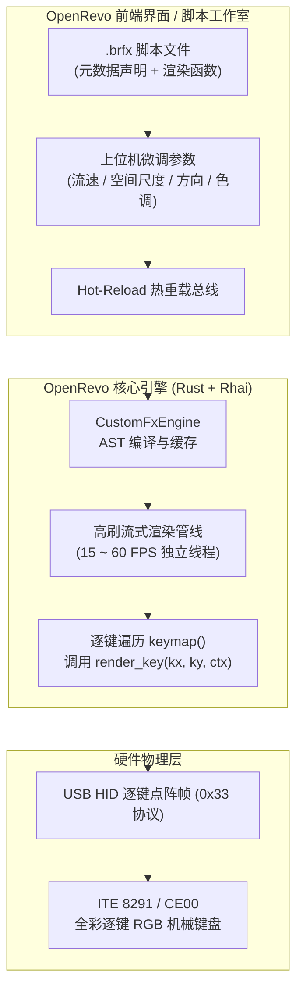

# BetterRGB 自定义灯效脚本 (*.brfx) 开发指南

> 文档首页：[docs/README.md](../README.md) · 核心引擎与 SDK：[core/README.md](README.md) · AI Agent 入口：[docs/skill.md](../skill.md)

> **“将每一个像素的色彩与几何控制权，100% 交付给玩家与极客。”**  
> OpenRevo 突破了传统笔记本键盘背光千篇一律、生硬死板的固件动画限制。通过内置基于 Rust 解释器的 **BetterRGB 空间高刷动态流光引擎**，OpenRevo 支持通过专用的脚本格式 `*.brfx` 实现 15 ~ 60 FPS 逐帧平滑渲染。无论你是想复刻炫酷的粒子对波、极坐标数学繁花，还是让键盘滚动展示赛博弹幕，只需几行代码即可瞬间点亮物理键盘！

---

## 目录
1. [核心概念与架构设计](#1-核心概念与架构设计)
2. [工作流与界面操作](#2-工作流与界面操作)
3. [文件存储与热重载机制](#3-文件存储与热重载机制)
4. [脚本结构与元数据声明 (Header Tags)](#4-脚本结构与元数据声明-header-tags)
5. [核心渲染函数与坐标系规范 (render_key)](#5-核心渲染函数与坐标系规范-render_key)
6. [内置数学、几何与颜色函数库](#6-内置数学几何与颜色函数库)
7. [4 个官方内置演示案例剖析](#7-4-个官方内置演示案例剖析)
8. [实战教程：从零编写你的第一个灯效脚本](#8-实战教程从零编写你的第一个灯效脚本)
9. [性能调优与避坑指南 (FAQ)](#9-性能调优与避坑指南-faq)

---

## 1. 核心概念与架构设计

OpenRevo 键盘背光系统由三大驱动引擎组成：
1. **原厂固件 (0% CPU)**：由 ITE 8291 等板载 MCU 芯片内置硬件定时器驱动，零系统资源消耗；
2. **独家算法 (BetterRGB)**：OpenRevo 内置的 14 种原生高精度空间几何投影预设（波浪、同心涟漪、双正弦流沙、落雷闪电、烈焰等）；
3. **定制脚本 (BetterRGB)**：**开放式脚本工作室**，运行在专用的轻量安全脚本解释器引擎（基于嵌入式 **Rhai**）之上，以 15 FPS ~ 60 FPS 的独立渲染线程逐键计算每一个物理按键的 RGB 颜色，并毫秒级下发至键盘硬件。



---

## 2. 工作流与界面操作

在 OpenRevo 客户端中：
1. 点击左侧导航栏 **「RGB 灯效工坊」**；
2. 在键盘背光工作台的【驱动引擎】一栏，选中 **「定制脚本 (BetterRGB)」**；
3. 界面将无缝展开 **定制动效脚本工作室**：
   - **动效脚本选择框**：下拉即可实时切换已安装的 `.brfx` 动效；
   - **【刷新】按钮**：重新扫描磁盘脚本并触发热编译；
   - **【查看源码】按钮**：弹窗展示当前脚本源代码，可一键复制，或点击【在记事本中打开】直接唤起 Windows 本地文本编辑器进行编辑；
   - **【导入】与【导出】**：支持快速导入好友分享的 `.brfx` 文件，或将自己调校满意的特效导出分享到社区；
   - **上位通用参数微调（实时映射）**：
     - **动效流速**：`0.2x ~ 3.0x` 平滑调速；
     - **空间尺度 / 扩散**：`50% ~ 250%` 几何缩放；
     - **流动方向**：向右 `→`、向左 `←`、向上 `↑`、向下 `↓`；
     - **击键互动**：开启 / 关闭按键物理反馈联动；
     - **定制主色调**：提供预设色调与原生拾色器，实时注入脚本。

---

## 3. 文件存储与热重载机制

### 本地物理路径
所有自定义灯效脚本存放在当前 Windows 用户数据目录下：
```text
%APPDATA%\OpenRevo\custom_effects\
```
*(在资源管理器地址栏直接输入并回车即可进入)*

> [!NOTE]
> **自动播种与自愈保障**：首次启动或该目录为空时，OpenRevo 会自动在此目录下生成 4 个官方演示文件：
> - `kamehameha.brfx`（龟派气功 vs 终极闪光）
> - `cyber_lotus.brfx`（赛博青莲）
> - `singularity.brfx`（引力黑洞）
> - `marquee.brfx`（文字弹幕）
>
> 即使误删或文件编码损坏，系统也能智能自愈补齐。

### 极速编写与热重载体验
在编写 `.brfx` 动效时，**完全无需重启 OpenRevo**：
1. 在 OpenRevo 界面点击 **【查看源码】** → **【在外部记事本打开】**；
2. 在记事本（或 VS Code 等编辑器）中修改算法代码并保存（`Ctrl + S`）；
3. 切换回 OpenRevo 点击 **【刷新】**，新算法将毫秒级编译并立即生效于物理键盘！

---

## 4. 脚本结构与元数据声明 (Header Tags)

一个标准的 `.brfx` 脚本由两部分构成：
1. **顶部元数据声明注释**（配置脚本名、默认滑条参数等）；
2. **核心逐键渲染函数 `render_key(kx, ky, ctx)`**。

### 元数据标签清单

在脚本最顶部，使用 `// @<tag>: <value>` 格式进行声明：

| 标签 | 类型 | 示例 | 说明 |
| :--- | :--- | :--- | :--- |
| `@name` | 字符串 | `赛博青莲 (Cyber Lotus)` | UI 下拉列表中展示的动效名称 |
| `@author` | 字符串 | `OpenRevo Community` | 作者署名 |
| `@version` | 字符串 | `2.0.0` | 脚本版本号 |
| `@description` 或 `@desc` | 字符串 | `6瓣极坐标青莲舒展盛开...` | 动效的详细描述、物理原理或玩法提示 |
| `@tags` | 逗号分隔字符串 | `极坐标, 莲花, 赛博朋克` | 分类检索标签 |
| `@default_speed` 或 `@speed` | 浮点数 | `1.0` | 默认动效流速（上位机滑动条推荐范围 `0.2 ~ 3.0`） |
| `@default_scale` 或 `@scale` | 浮点数 | `1.0` | 默认空间尺度（上位机滑动条推荐范围 `0.5 ~ 2.5`） |
| `@default_direction` 或 `@direction` | 整数 | `0` | 默认方向：`0`=向右, `1`=向左, `2`=向上, `3`=向下 |
| `@default_reactive` 或 `@reactive` | 布尔值 | `false` | 默认是否开启击键互动响应 |
| `@default_color` 或 `@color` | 颜色 Hex | `#00FFFF` | 默认主色调（形如 `#RRGGBB`） |
| `@default_text` 或 `@text` | 字符串 | `I LOVE OPEN-REVO` | 默认弹幕内容（跑马灯/文本类动效专用） |

#### 头部注释完整示例
```rhai
// ==========================================
// @name: 幻境波纹 (Mirage Wave)
// @author: Neo
// @version: 1.0.0
// @description: 高频干涉正弦波浪，全键盘色彩交织
// @tags: 波浪, 渐变, 霓虹
// @default_speed: 1.2
// @default_scale: 1.0
// @default_direction: 0
// @default_reactive: false
// @default_color: #6366F1
// ==========================================
```

---

## 5. 核心渲染函数与坐标系规范 (render_key)

在每个渲染帧中，引擎会针对键盘上的**每一个物理按键**调用一次 `render_key` 函数。

```rhai
fn render_key(kx, ky, ctx) {
    // 1. 根据 kx, ky 与 ctx 计算颜色
    // 2. 返回包含 R, G, B 三个分量的数组 [r, g, b]
    return [255.0, 0.0, 128.0];
}
```

### 1. 输入参数详解

#### `kx`（浮点数 `f64`）：按键水平几何坐标
表示按键在物理键盘上的横向空间相对位置，取值范围约为 **`0.0 ~ 19.5`**：
- **`0.0 ~ 0.5`**：最左侧功能键与修饰键（`Esc`, `~`, `Tab`, `CapsLock`, `CtrlL`）；
- **`1.0 ~ 12.0`**：主键盘字母与数字打字区；
- **`13.5`**：主键区最右侧大键（`Backspace`, `Enter`, `ShiftR`）；
- **`12.25 ~ 13.25`**：独立方向键区域；
- **`15.5 ~ 18.5`**：右侧独立数字小键盘区（`NumLock` 至 `NumpadEnter`）。

#### `ky`（浮点数 `f64`）：按键垂直几何坐标
表示按键所在的行物理位置，取值范围约为 **`0.0 ~ 5.25`**：
- **`0.0`**：第 0 行 —— 功能键行（`Esc`, `F1` ~ `F12`, `PrtSc`, `Del` 等）；
- **`1.0`**：第 1 行 —— 数字键行（`~`, `1` ~ `0`, `Backspace` 等）；
- **`2.0`**：第 2 行 —— `Tab`, `Q` ~ `P` 行；
- **`2.5`**：大回车（`Enter`）几何中心；
- **`3.0`**：第 3 行 —— `CapsLock`, `A` ~ `L` 行；
- **`4.0`**：第 4 行 —— `ShiftL`, `Z` ~ `M` 行；
- **`4.75`**：上方向键（`ArrowUp`）；
- **`5.0`**：第 5 行底栏 —— `Ctrl`, `Win`, `Alt`, 空格键（`Space`）；
- **`5.25`**：下沉方向键（`ArrowLeft`, `ArrowDown`, `ArrowRight`）。

> [!TIP]
> **键盘中心点参考**：
> - 纯主键区中心点约为：`x = 7.0, y = 2.5`（适合作为莲花、涟漪等居中特效的原点）；
> - 包含小键盘的全键盘几何中心点约为：`x = 9.0 ~ 9.5, y = 2.5`（适合作为全盘碰撞或全局黑洞的原点）。

#### `ctx`（字典结构 `Map`）：上位机实时环境上下文
上位机微调参数会在每一帧打包装入 `ctx` 传递给脚本：

| 属性 | 类型 | 含义 |
| :--- | :--- | :--- |
| `ctx.t` | `f64` | 全局持续递增平滑时间戳（单位：秒）。随着时间推移自然增大，用于驱动物理动画。 |
| `ctx.speed` | `f64` | 上位机当前调节的动效流速倍率（如 `1.0`, `1.5`）。 |
| `ctx.scale` | `f64` | 上位机当前调节的空间尺度/扩散倍率（如 `1.0`, `2.0`）。 |
| `ctx.direction` | `i64` | 上位机选择的流动方向：`0`=向右, `1`=向左, `2`=向上, `3`=向下。 |
| `ctx.reactive` | `bool` | 上位机击键互动开关：`true` 为已开启，`false` 为关闭。 |
| `ctx.color` | `string` | 上位机定制主色调 Hex 字符串（如 `"#00F0FF"`）。 |
| `ctx.text` | `string` | 弹幕文本字符串（可在上位机动态设置文字内容）。 |

### 2. 返回值要求
函数必须返回一个包含 3 个浮点数值的数组：
```rhai
return [r, g, b];
```
- 分量范围严格为 **`0.0 ~ 255.0`**。
- 强烈建议在返回前使用内置的 `clamp(v, 0.0, 255.0)` 函数进行边界截断，防止数值溢出导致显示异常。

---

## 6. 内置数学、几何与颜色函数库

为保障极客算法能够高效运行，OpenRevo 在底层为 Rhai 引擎预先注入了丰富的原生数学、几何与色彩处理函数，执行效率极高：

### 1. 三角函数与角度计算
- `sin(x)`：正弦函数（支持浮点与整数参数）；
- `cos(x)`：余弦函数；
- `tan(x)`：正切函数；
- `atan2(y, x)`：计算方位角（极坐标变换核心函数，返回弧度 `-\pi ~ \pi`）。

### 2. 算术、极值与空间距离
- `sqrt(x)`：开平方根（内置安全防爆，负数安全返回 `0.0`）；
- `abs(x)`：求绝对值；
- `pow(x, p)`：求幂运算 $x^p$；
- `min(a, b)` / `max(a, b)`：取较小值 / 较大值；
- `clamp(v, min, max)`：将数值截断在 `[min, max]` 区间内；
- `floor(x)` / `ceil(x)`：向下取整 / 向上取整；
- `dist(x1, y1, x2, y2)`：计算两点间的二维欧几里得空间距离 $\sqrt{(x_1-x_2)^2 + (y_1-y_2)^2}$；
- `smoothstep(edge0, edge1, x)`：Hermite 阶梯光滑渐变插值，常用于光晕软边缘、冲击波衰减。

### 3. 色彩空间转换
- `hsv(h, s, v)`：将 HSV 颜色转换为 RGB 数组 `[r, g, b]`：
  - `h`：色相，范围 `0.0 ~ 360.0`（0=红, 120=绿, 240=蓝）；
  - `s`：饱和度，范围 `0.0 ~ 1.0`；
  - `v`：明度/光强，范围 `0.0 ~ 1.0`（可配合放大因子缩放）。
  - 返回：`[r, g, b]` 数组（数值已缩放至 `0.0 ~ 255.0`）。

### 4. 跑马灯点阵字符采样 (Marquee Text Engine)
OpenRevo 内置了一套精细的 ASCII 6 行高度等宽字符点阵库（全面覆盖英文字母 `A~Z`、数字 `0~9`、以及 `!`, `.`, `:`, `-`, `_`, `+`, `/`, `♥` 等符号）：
- `sample_text(text, x, y)`：对给定字符串进行微米级点阵采样。
  - 参数：`text` 待显示的文本，`x` 当前采样的横向偏移，`y` 垂直采样行高；
  - 返回：`0.0`（未命中文字点阵）或 `1.0`（命中文字高光）；
- `get_text_width(text)`：计算整段文字在点阵空间的总像素宽度，用于计算无缝循环滚动周期。

---

## 7. 4 个官方内置演示案例剖析

学习编写 `.brfx` 动效的最佳捷径，就是仔细阅读官方预置的 4 个演示文件。它们分别展示了不同的高级灯效设计范式：

### 案例 1：`kamehameha.brfx` —— 多阶段状态机循环与激波碰撞
- **设计范式**：**有限状态机 (FSM) + 空间射线相交 + 伪随机高能电弧**
- **核心逻辑剖析**：
  - 整个动效以 `6.5 秒` 为一个闭环周期：`let t_cycle = (ctx.t * ctx.speed) % 6.5;`
  - **阶段 1 (0.0s ~ 1.2s)**：左侧幽蓝激光龙头（`head_x`）呼啸向右推进，通过 `sqrt` 计算龙头球体并赋予多层光晕；
  - **阶段 2 (1.2s ~ 2.4s)**：右侧金色终极闪光反向冲刺；
  - **阶段 3 (2.4s ~ 5.4s)**：两股光束在中心激荡对撞，加入高频随机电弧：
    ```rhai
    let spark_seed = sin(kx * 19.37 + ky * 41.29 + ctx.t * 55.0);
    if spark_seed > 0.82 { ... }
    ```
  - **阶段 4 (5.4s ~ 6.5s)**：对波临界失衡引发超新星大爆炸与环形激波消散。

### 案例 2：`cyber_lotus.brfx` —— 极坐标几何繁花与多频干涉星芒
- **设计范式**：**极坐标方程 (`atan2`, `sqrt`) + 优雅呼吸脉冲 + 非公度波干涉**
- **核心逻辑剖析**：
  - 将打字区中心设定为极坐标原点：
    ```rhai
    let dx = (kx - 7.0) / ctx.scale;
    let dy = ((ky - 2.5) * 1.5) / ctx.scale;
    let r_dist = sqrt(dx * dx + dy * dy);
    let angle = atan2(dy, dx);
    ```
  - 运用余弦花瓣函数构建 6 瓣舒展莲花：
    ```rhai
    let petal_lobe = cos(6.0 * (angle + spin));
    let petal_r = 3.6 + breathe + 1.6 * petal_lobe;
    ```
  - 利用非公度正弦频率生成自然闪动的“流萤星芒”，点缀右上角与独立数字小键盘，告别冷清与死黑。

### 案例 3：`singularity.brfx` —— 天体物理吸积盘与相对论多普勒频移
- **设计范式**：**引力透镜 + 旋转物质流 + 相对论红移与蓝移**
- **核心逻辑剖析**：
  - 中心划定绝对事件视界半径：`if r_dist < 1.2 { return [0.0, 0.0, 0.0]; }`，纯黑深邃；
  - 外圈利用 `doppler = cos(angle)` 模拟物质流面向观察者旋转时的相对论效应：迎向产生高能蓝移（亮紫青光），背向产生红移（炽热红橙）。

### 案例 4：`marquee.brfx` —— 全键盘赛博文字弹幕
- **设计范式**：**点阵位图采样 + 彩虹色散 + 物理按键避让**
- **核心逻辑剖析**：
  - 避让下沉方向键：`if ky > 5.05 { return [0.0, 0.0, 0.0]; }`，防止大文字在下沉按键上产生扭曲；
  - 调用内置 `sample_text` 进行点阵命中测试；
  - 命中文字后，使用 `hsv` 结合按键横坐标动态生成横向流动的赛博全光谱高光。

---

## 8. 实战教程：从零编写你的第一个灯效脚本

下面我们动手实现一个名为 **「量子心跳 (Quantum Pulse)」** 的自定义动效：以主键盘中心为原点，带有柔和的心跳双连击律动，并向四周扩散同心能量环。

### 第一步：新建脚本文件
在 `%APPDATA%\OpenRevo\custom_effects\` 目录下新建文本文件，重命名为 `quantum_pulse.brfx`。

### 第二步：编写完整代码
将以下代码填入文件中并保存：

```rhai
// ==========================================
// @name: 量子心跳 (Quantum Pulse)
// @author: Geeker
// @version: 1.0.0
// @description: 双连击心跳律动，向全键盘扩散幽蓝能量光环
// @tags: 脉冲, 心跳, 涟漪
// @default_speed: 1.0
// @default_scale: 1.0
// @default_direction: 0
// @default_reactive: false
// @default_color: #00F0FF
// ==========================================

fn render_key(kx, ky, ctx) {
    // 1. 设置中心点在主键区中心 (G/H 键附近)
    let center_x = 7.5;
    let center_y = 2.5;

    // 2. 计算当前按键距离中心点的几何距离 (应用上位机 scale 缩放)
    let dx = (kx - center_x) / ctx.scale;
    let dy = ((ky - center_y) * 1.4) / ctx.scale;
    let dist = sqrt(dx * dx + dy * dy);

    // 3. 构造 1.2 秒为周期的双峰心跳节奏 (咚...咚...)
    let t = (ctx.t * ctx.speed) % 1.2;
    let pulse = 0.0;
    if t < 0.18 {
        // 第一拍心跳 (快速收缩放大)
        pulse = sin(t / 0.18 * 3.14159);
    } else if t > 0.28 && t < 0.46 {
        // 第二拍心跳 (略微柔和)
        pulse = sin((t - 0.28) / 0.18 * 3.14159) * 0.75;
    }

    // 4. 计算向外扩散的同心能量波
    let wave_radius = t * 14.0;
    let wave_diff = abs(dist - wave_radius);
    let wave_glow = 0.0;
    if wave_diff < 1.5 {
        wave_glow = (1.0 - wave_diff / 1.5) * max(0.0, 1.0 - dist / 12.0);
    }

    // 5. 基础底光 (防止周围按键彻底死黑)
    let r = 5.0;
    let g = 12.0;
    let b = 25.0;

    // 6. 中心心脏核心渲染
    if dist < 2.5 {
        let core = (1.0 - dist / 2.5) * pulse;
        r += 240.0 * core;
        g += 60.0 * core;
        b += 140.0 * core;
    }

    // 7. 叠加上扩散波纹
    r += 20.0 * wave_glow;
    g += 180.0 * wave_glow;
    b += 255.0 * wave_glow;

    // 8. 安全输出并截断
    return [clamp(r, 0.0, 255.0), clamp(g, 0.0, 255.0), clamp(b, 0.0, 255.0)];
}
```

### 第三步：热重载测试
打开 OpenRevo 客户端，进入「RGB 灯效工坊」，点击【刷新】，即可在下拉菜单中看到 **量子心跳 (Quantum Pulse)**！物理键盘将立即呈现出充满未来科技感的心跳扩散动效。

---

## 9. 性能调优与避坑指南 (FAQ)

### Q1：为什么我的脚本在界面上点击后没有反应或弹窗报错？
- **检查 Rhai 语法**：Rhai 语法虽然高度贴近 Rust/JS，但有一些细节区别：
  - 声明变量**统一使用 `let`**（不支持 `let mut`，直接 `let a = 1; a = 2;` 即可）；
  - 语句末尾**必须以分号 `;` 结尾**；
  - 浮点数计算建议明确带有小数点（如 `2.0` 而不是 `2`），避免某些运算符的隐式转换歧义。
- **查看控制台日志**：打开 OpenRevo 日志目录查看 `CUSTOM_FX` 模块输出的编译报错，会精准指出语法错误行号。

### Q2：脚本运行时会不会占用过高的 CPU？
- **极轻量运行**：Rhai AST 在载入时被直接编译为字节码并常驻内存，每秒 30~60 帧的运算消耗在现代 CPU（如 13/14 代酷睿或锐龙平台）上仅占用 **< 0.5%** 的单核极小瞬时负荷；
- **防死循环机制**：OpenRevo 内核对每次 `render_key` 调用设定了严格的指令步数熔断上限（`max_operations = 50,000`）。严禁在 `render_key` 中写无界 `while` 大循环，否则会被安全拦截并降级。

### Q3：如何让动效能够响应上位机的流动方向与主色调？
- **流动方向联动**：通过 `ctx.direction` 判定：
  - 若为 `0`（向右），流向偏移使用 `kx - ctx.t * speed`；
  - 若为 `1`（向左），流向偏移使用 `kx + ctx.t * speed`；
  - 若为 `2`（向上），流向偏移使用 `ky + ctx.t * speed`；
  - 若为 `3`（向下），流向偏移使用 `ky - ctx.t * speed`。
- **自定义主色联动**：
  可以直接配合 `ctx.color` 或利用 `hsv` 结合色相进行色调偏移。

### Q4：支持在脚本中保存跨帧状态或全局变量吗？
- `render_key` 是**无副作用的纯渲染函数**。每一帧由系统统一通过 `ctx.t` 推进物理时间，请不要尝试在脚本中定义全局可变累加变量。所有时间驱动请统一以 `ctx.t` 为基准展开计算。

---

## 接下来

- 返回核心引擎说明：[核心引擎与 SDK 导览](README.md)
- 返回全仓文档总目录：[OpenRevo 文档首页](../README.md)
